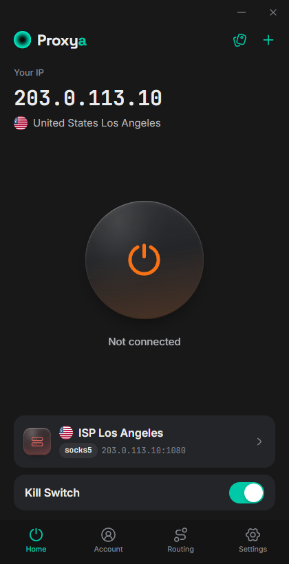
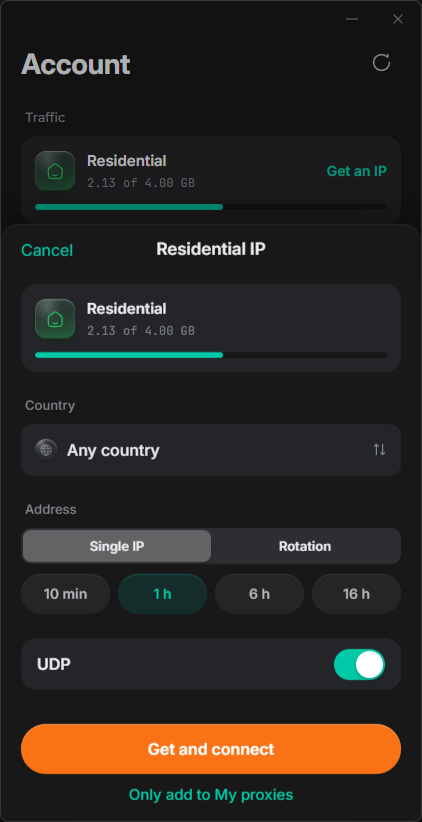
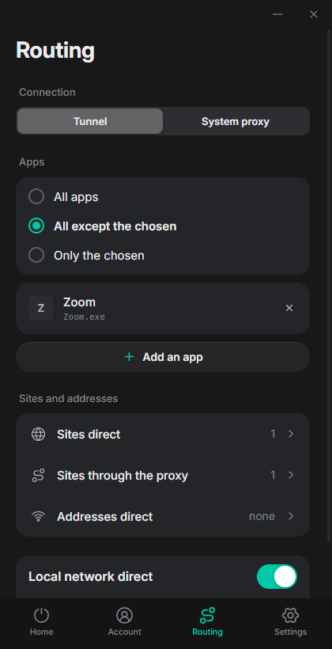
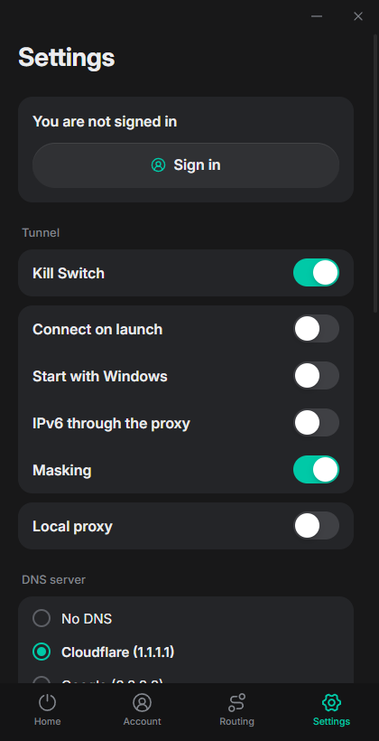

# Proxya Desktop

  

  <strong><a href="https://github.com/ProxyaAnty/Proxya-Desktop/releases/latest">Download Proxya Desktop</a></strong> 
  Windows x64, macOS Apple Silicon

**Proxya Desktop is a SOCKS5 and HTTP proxy client for Windows and macOS.**
Route traffic through a TUN tunnel, configure split tunneling by application
and website, and generate residential proxies directly in the app.

Use proxies from [Proxya](https://proxya.co) or another provider. A Proxya
account is optional when adding your own proxies.

## Features

- **TUN tunnel:** route traffic from applications, including those without
  built-in proxy settings. UDP and QUIC require a SOCKS5 proxy with UDP support.
- **Split tunneling:** apply proxy rules to all applications, selected
  applications, or all except selected applications. Set separate rules for
  websites, IP addresses and the local network.
- **System proxy mode:** use the operating system's proxy settings with
  compatible applications, without installing the tunnel service.
- **Residential proxy generation:** select a country, a sticky IP or IP
  rotation, and UDP support using your Proxya traffic balance.
- **Proxy management:** add SOCKS5 and HTTP proxies, check authentication and
  UDP availability, and view the proxy's exit location.
- **Proxya account:** access active datacenter, ISP and mobile proxy orders
  from the desktop app.
- **Connection settings:** DNS over HTTPS, handshake masking (on by default),
  automatic connection on launch and a Windows kill switch.
- **Interface languages:** English, Russian and Chinese, with no restart
  required when switching languages.

  

## Download and installation

Download the latest version from
[GitHub Releases](https://github.com/ProxyaAnty/Proxya-Desktop/releases/latest).

| Platform | Download | Installation guide |
| --- | --- | --- |
| Windows x64 |  `Proxya_1.1.0_x64-setup.exe` | [Windows installation](docs/windows-installation.md) |
| macOS Apple Silicon |  `Proxya-macos-arm64.dmg`, or the [`.tar.gz` archive](https://github.com/ProxyaAnty/Proxya-Desktop/releases/download/v1.1.0/Proxya-macos-arm64.tar.gz) | [macOS installation](docs/mac-installation.md), [Russian guide](docs/mac-установка.md) |

SHA-256 checksums are included with each release. The Windows installer is
not Authenticode signed. The macOS app is ad-hoc signed and is not notarized;
its installation guide covers the required Gatekeeper steps.

## Generate residential proxies in the app

Sign in to your Proxya account to generate residential SOCKS5 proxies from your
available traffic balance. The generator provides country selection, a sticky
IP with a selected duration or IP rotation, and an option to enable UDP.

Select **Get and connect** to generate a proxy and connect immediately, or add
it to **My proxies** for later. The same screen shows your remaining
residential traffic. Generation requires residential traffic on your account.

  

## Split tunneling and proxy settings

Choose tunnel or system proxy mode, then configure routing for the applications
and websites you use. Website and IP rules support direct connections, while
selected websites can always use the proxy. Local network traffic can be
excluded from the tunnel.

Settings include DNS selection, startup behavior, local proxy access and the
Windows kill switch.

  
  

## Connection modes

| Mode | Traffic coverage | Requirements |
| --- | --- | --- |
| Tunnel | Application traffic covered by routing rules; TCP and supported UDP | A tunnel service installed with administrator approval |
| System proxy | Applications that use the operating system's proxy settings; TCP | No tunnel service or administrator rights for this mode |

The service checks the proxy before connecting. If UDP relay is unavailable,
UDP is blocked within the tunnel's routing scope. System proxy mode does not
provide UDP tunneling.

## DNS and connection protection

With **Resolved by the proxy**, the default, the proxy resolves destination
names. The name travels in the proxy handshake, and masking splits it so that
no single packet carries it whole. Selecting Cloudflare, Google, Quad9 or
AdGuard enables DNS over HTTPS through the proxy instead. That adds a lookup
through the proxy for every new site, about 0.6 s in our tests.

The Windows kill switch blocks traffic outside the permitted tunnel routes
while it is active. Proxy passwords and account sessions are encrypted on disk
using a key held in Windows Credential Manager or macOS Keychain.

### Handshake masking

Masking is on by default. The connection to a SOCKS5 or HTTP proxy is not
encrypted, and some networks read two things from it: the destination address
in the proxy handshake, and the site name (TLS server name) in the first packet
inside the stream. Masking splits both across two TCP segments with a random
10–30 ms pause, at a random point inside the address or name, so no single
packet carries either of them whole.

The greeting, sign-in and request are sent together without waiting for each
reply, so a connection opens about 0.4 s faster than without masking. Proxies
that need the step-by-step exchange are detected automatically.

Masking does not encrypt the proxy connection or prevent inspection of a
reassembled stream.

Recorded test on a network that filters individual packets, same proxies and
link:

| Destination | Without masking | With masking |
| --- | --- | --- |
| Telegram data centers, ISP proxy | 0 of 12 | 12 of 12 |
| Instagram over TLS, ISP proxy | 0 of 4 | 4 of 4 |
| Telegram and Instagram, residential proxy | 0 of 9 | 20 of 20 |

Results describe that test and depend on the network and filtering method.

## Platform support and limitations

- The kill switch is available on Windows. It is not available on macOS.
- The macOS build supports Apple Silicon. Intel Macs are not supported.
- IPv6 is disabled by default. Enable it only if your proxy supports IPv6.
- Another VPN may take precedence over the tunnel. On Windows, Proxya checks
  which adapter carries the traffic after connecting, and if another VPN does,
  it disconnects with an explanation instead of showing a connection that is
  not in effect. Beside another VPN, use system proxy mode: with **Only the
  chosen** apps, the selected apps use the proxy and the rest stay on the other
  VPN.
- Reachable destinations and ports depend on your proxy provider's policies.

## Documentation and support

This repository contains installation guides, screenshots, the issue tracker
and release downloads. The application source code is not published here.

Report application issues through
[GitHub Issues](https://github.com/ProxyaAnty/Proxya-Desktop/issues).
For account and billing questions, use [Proxya support](https://proxya.co/contact).
Report security concerns privately as described in [SECURITY.md](SECURITY.md).

Proxy addresses shown in screenshots use ranges reserved for documentation.
No proxy passwords or account credentials are displayed.

## Licensing and third-party components

Repository documentation is licensed under [MIT](LICENSE). The desktop
application is distributed under the [binary license](BINARY-LICENSE.md).

Proxya Desktop uses [sing-box](https://github.com/SagerNet/sing-box) as its
tunnel engine. The unmodified upstream executable is distributed separately
with its GPL-3.0 license. The build process verifies the upstream SHA-256.

---

© 2026 Proxya
